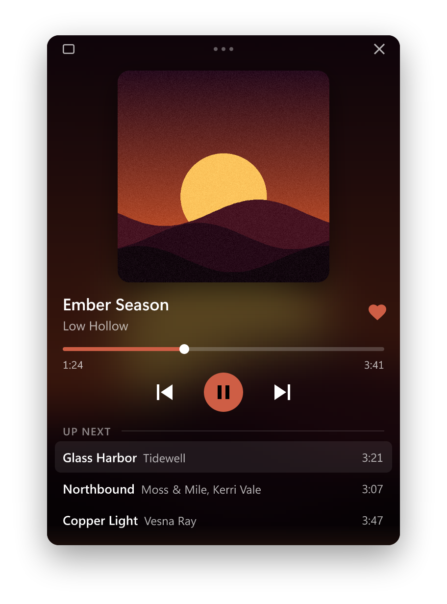
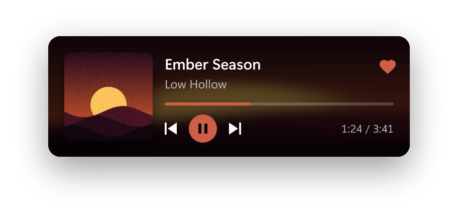
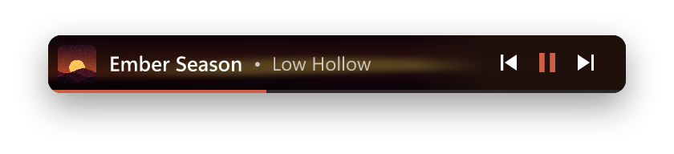
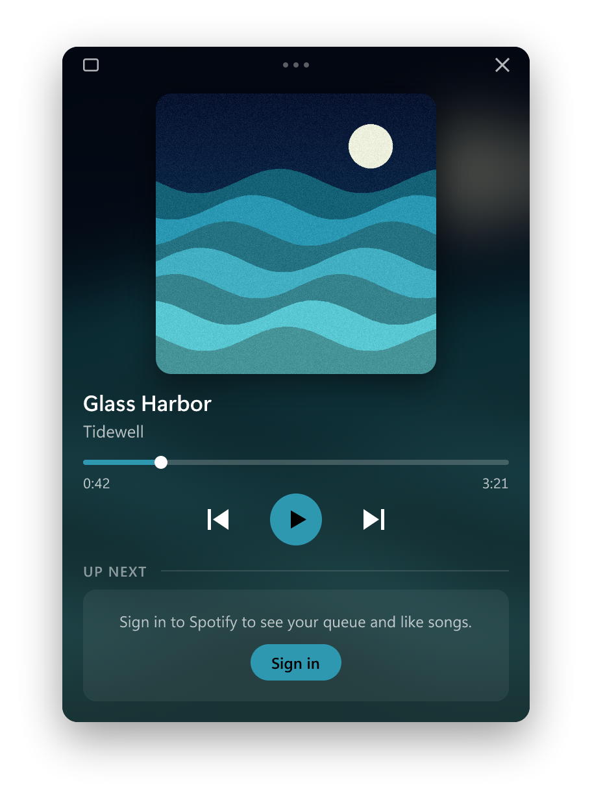
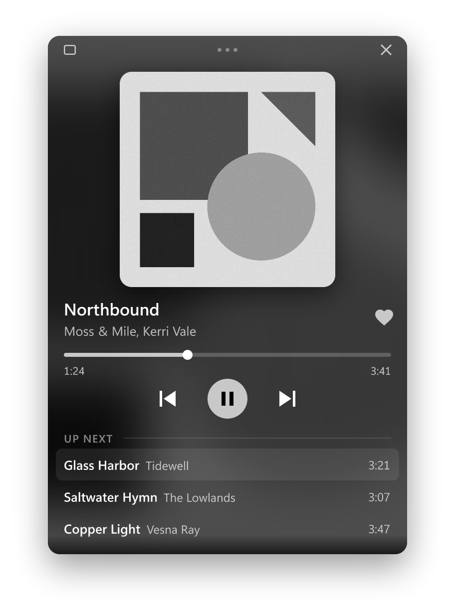
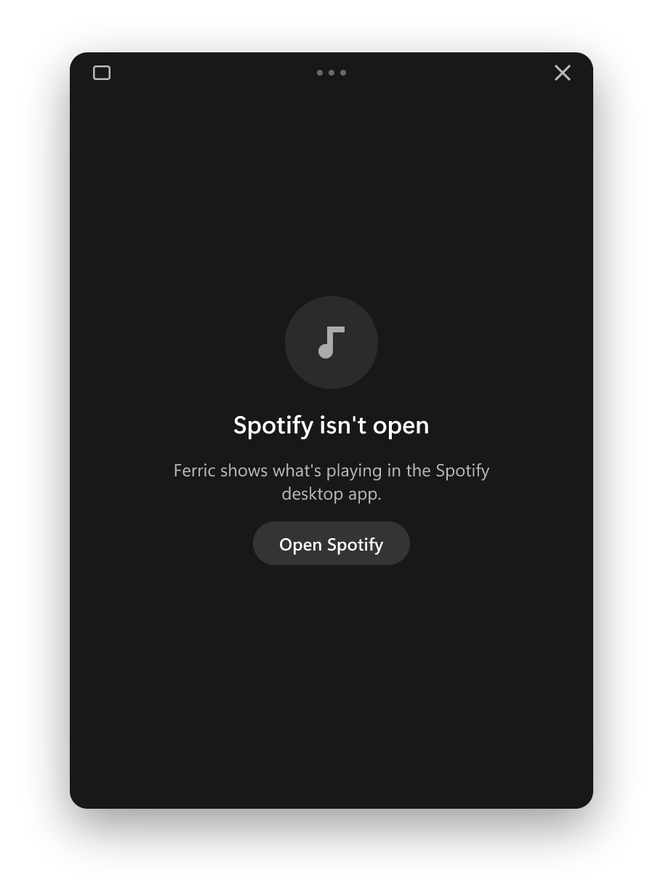
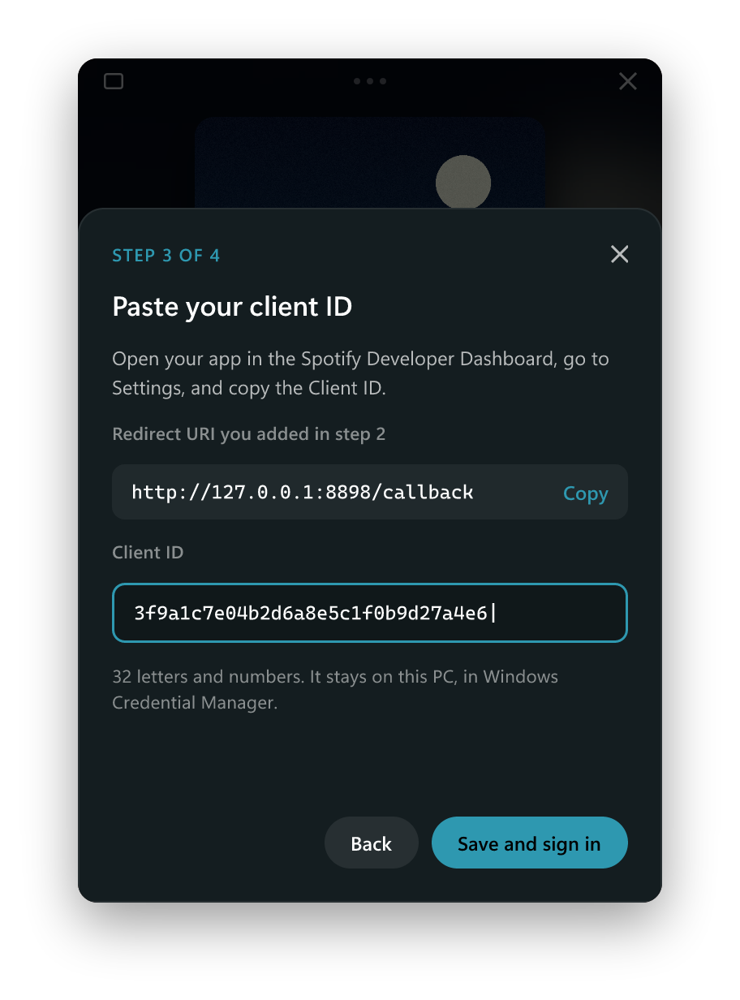

# UI mockups

The source is [`design/ferric-ui.figcraft`](../../design/ferric-ui.figcraft) (FigCraft). The PNGs below are 2× exports. **They are the visual spec for T04, T09 and T10.** Where a task file and a mockup disagree on looks, the mockup wins. Behavior is still defined by the task file.

The cover art in the mockups is placeholder art drawn for this project. The track and artist names are made up.

| Mockup | Used by |
| --- | --- |
|  | T04 |
|  | T09 |
|   | T09 |
|  | T09 (queue sign-in row), T04 (paused state) |
|  | T09 |
|  | T04 |
|  | T10 |

## Tokens

| Token | Value | Notes |
| --- | --- | --- |
| Font | Segoe UI Variable | Display optical size for 15–17 px, Text for 12–13, Small for 11 |
| Mono font | Cascadia Mono | Client ID, redirect URI |
| `--text` | `#FFFFFF` | |
| `--text-muted` | `#FFFFFF` at 70% (`#FFFFFFB3`) | artists, times, body copy |
| `--text-faint` | `#FFFFFF` at 50% (`#FFFFFF80`) | section labels, help text |
| `--track` | `#FFFFFF` at 20% | progress track |
| `--hover` | `#FFFFFF` at 8% | row hover, ghost buttons |
| `--surface` | `#FFFFFF` at 6% | sign-in prompt, fields |
| `--accent` | from the theme (Ember `#CE5E45`, Tide `#2E98B0`) | progress fill, play button, heart, primary buttons |
| `--on-accent` | from the theme (black in all three samples) | icon/text on the accent |
| Plain background | `#181818` | |
| Mono accent | `#C8C8C8` | |
| Window radius | 12 (Full, Card), 8 (Strip) | |
| Window shadow | 0 12 32 `#00000066` | the Tauri window shadow does this in the app |

## Full (360×520)

| Element | Position / size | Style |
| --- | --- | --- |
| Title strip | y 0–28 | mode icon 12×10 at (16, 9); 3 grip dots 4 px at x 170/178/186, y 12; close 10×10 at (334, 9). Drag region = whole strip except the icons |
| Artwork | 216×216 at (72, 36), centered | radius 12, shadow 0 8 24 `#00000080` |
| Title | (16, 262) | 17 Semibold, one line, ellipsis |
| Artists | (16, 287) | 13 Regular, muted |
| Heart | 18×16 at (326, 272) | accent when liked; outline muted when not; hidden when `liked === null` |
| Progress | track 328×4 at (16, 318), radius 2; knob 10 px white, centered on the fill end | fill = accent |
| Times | y 328 | 11 Regular, tabular numbers; duration right-aligned to x 344 |
| Controls | centers y 364; prev 16 px at x 112, play 40 px circle at x 160, next 16 px at x 232 | play = accent circle, on-accent icon |
| "UP NEXT" | (16, 396) | 11 Semibold, letter-spacing 0.6, faint; 1 px divider `#FFFFFF1F` from x 76 to 344 at y 403 |
| Queue rows | x 8, w 344, h 32, from y 414; padding 0 8; gap 6 | title 13 Semibold + artists 12 muted (truncates) + duration 12 muted; hover = `--hover`, radius 6 |
| Bottom fade | y 500–520 | gradient to the background color, so the scrolling rows fade out |

## Card (360×120) and Strip (360×36)

- **Card**: art 88 at (16, 16), radius 8. Title 15 Semibold at (116, 17), max width 200. Artists 12 at (116, 39). Heart 16×14 at (328, 21). Progress 228×3 at (116, 66). Controls: prev 12 px at x 116, play 28 px circle at x 140, next at x 180, with centers at y 92. "1:24 / 3:41" right-aligned to x 344, at y 84.
- **Strip**: art 24 at (6, 6), radius 4. Title 13 Semibold + "•  Artist" 12 muted, from x 38, vertically centered, clipped at x 348. 2 px progress line along the bottom edge. **On hover**: a fade gradient from x 228, then prev / play-pause (in the accent color, no circle) / next, 10 px icons at x 282 / 306 / 330.

## States

- **Paused**: play triangle replaces the pause bars.
- **Signed out**: the queue area becomes a `--surface` box (radius 10, padding 14) with one muted line and an accent "Sign in" pill.
- **Spotify not open**: Plain background, a 64 px icon circle, "Spotify isn't open" (17 Semibold), one muted line, an "Open Spotify" ghost pill.
- **Onboarding**: dims the view (`#000000A6`) and slides up a panel from y 92 (radius 16 on the top corners, background `#141D20`, padding 20, gap 12), with a step label in the accent color, a 17 Semibold heading, muted body, a read-only redirect URI field with Copy, a client ID input (accent border when focused), help text, and Back + primary buttons at the bottom right.
