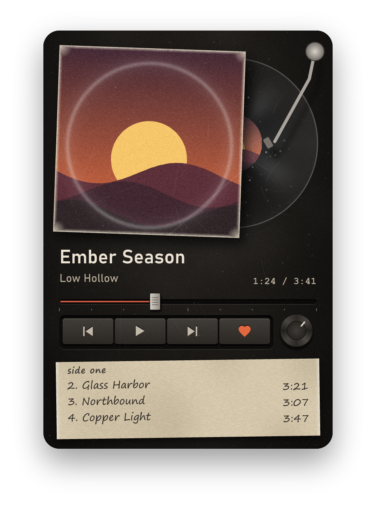
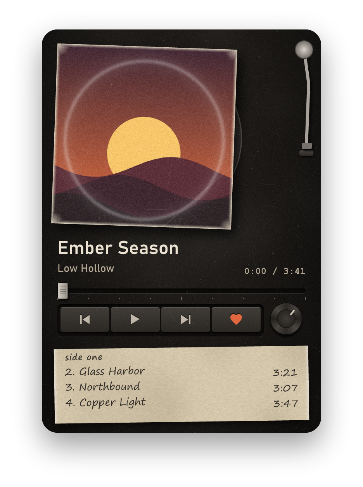
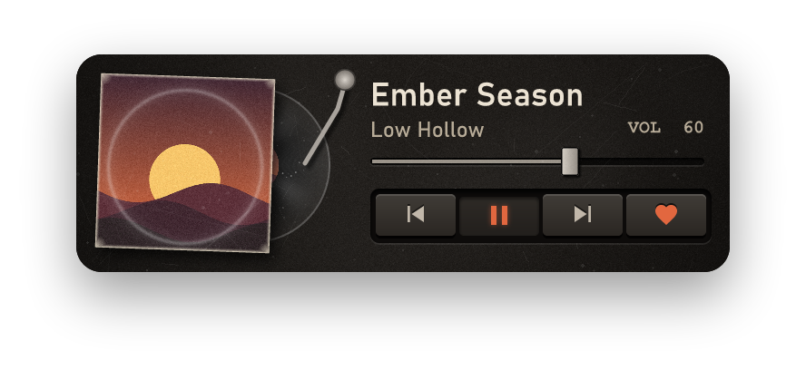
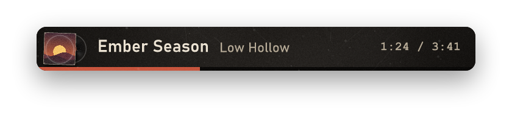
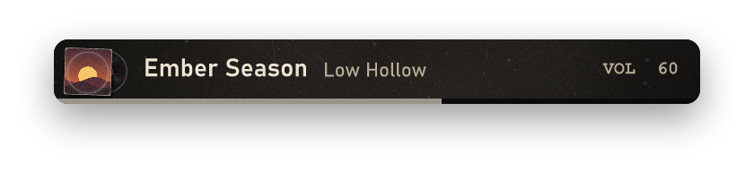

# UI design: "Sleeve and record"

The source file is [`design/ferric-ui.figcraft`](../../design/ferric-ui.figcraft) (FigCraft). It holds only the final design, plus the six "Spin" frames its prototype uses. The PNGs below are 2× exports. **They are the visual spec for T04, T09 and T10.** Where a task file and a mockup disagree on looks, the mockup wins. Behavior is still defined by the task file.

The cover art (Ember), track names and artists are placeholders made for this project. Every texture is procedural: [`design/tools/textures.py`](../../design/tools/textures.py) is the reference implementation, and T03 ports it to Rust.

## The idea

Ferric is a worn record and its sleeve sitting on a dark, scuffed turntable plinth. **The album art is the sleeve**, printed on aged card with ring wear, rubbed corners and a crease. The record slides out of the sleeve, and the tonearm sits on it while music plays. The controls are a bank of matte hardware keys. The queue is handwritten on the back of the sleeve.

Grit level 2: clearly used, never dirty enough to hurt readability.

## Final set

| | |
| --- | --- |
|  | **Full · Playing** (T04): record out and spinning, arm down, play key held down showing pause in the accent |
|  | **Full · Paused** (T04): arm lifted, record slows to a stop, play key up showing ▶ |
|  | **Full · Stopped** (T04): record slid back into the sleeve, arm on its rest, progress at 0 |
|  | **Card** (T09) |
|  | **Card · scrolling** (T09): the slider shows volume instead of progress |
|  | **Strip** (T09) |
|  | **Strip · hover** (T09): the time fades out and the keys appear |
|  | **Strip · scrolling** (T09) |

The FigCraft file has a clickable prototype (flow "Ferric — sleeve and record"): the record spins, clicking play/pause switches Playing and Paused, and pressing S switches to Stopped.

## Materials and tokens

| Token | Value | Use |
| --- | --- | --- |
| `--plinth` | `#1E1B18` + plinth texture | window background |
| `--ink` | `#EDE4D4` | title |
| `--ink-muted` | `#B8AC98` | artist, time |
| `--printed` | `#D9CFC0` at 65% | printed tick marks; icons at 85% |
| `--key-top` → `--key-bottom` | `#403C37` → `#2A2622` | raised key face (vertical gradient) |
| `--key-down` | `#2E2A26` → `#221F1C` + inner shadow | key held down |
| `--tray` | `#0D0B0A` + inner shadow | recessed key bank and slider slot |
| `--accent` | from the album (`theme.accent`); samples `#C8553D` (fill), `#E2673F` (icon glow) | progress, active play key icon, liked heart |
| `--volume` | `#D9CFC0` at 70% | slider fill while showing volume |
| `--pencil` | `#2F2A26` | handwritten queue on the card |
| Grain overlay | procedural grain, dust and hairline scratches, **20% opacity**, above everything | all modes |

| Type | Font | Use |
| --- | --- | --- |
| Title | Bahnschrift SemiBold (24 Full / 18 Card / 14 Strip) | always level, never rotated |
| Artist | Bahnschrift Regular (14 / 12 / 11) | |
| Time, "VOL 60" | Courier New Bold (12 / 10) | typewriter digits |
| Queue | Segoe Print (Regular 13, header Bold 11) | handwritten, rotated with its card |

All fonts ship with Windows 10/11, so none are bundled.

**Keys carry icons only, with no printed labels**: previous ⏮, play/pause, next ⏭, like ♥. The active state is shown by the key being held down plus the accent color, not by a text label or a light.

## Full (360×520, radius 20)

| Element | Position / size | Notes |
| --- | --- | --- |
| Sleeve (worn album art) | 232×232 at (16, 22), rotated −2° | shadow 6 8 14 `#000000B3` |
| Record | 212×212, centred (236, 140) when playing; behind the sleeve | rim light: 1.5 px `#FFFFFF33` |
| Tonearm | pivot 24 px at (326, 14); arm 4 px `#A9A39C` from (338, 26) via (328, 62) to the stylus | stylus at (278, 150) when playing; the angle follows progress (see Motion) |
| Title | (20, 268) | |
| Artist | (20, 300) | |
| Time | right-aligned to x 340, y 305 | |
| Slider slot | (20, 334) 320×6, radius 3 | 2 px played line inside it, in the accent; printed ticks every 40 px below |
| Slider cap | 14×22, metal (gradient `#D8D2C8`→`#8F8880`, 4 ridges) | centred on the current position |
| Key bank | tray (20, 354) 266×42 radius 6; keys 63×32 at x 24 / 89 / 154 / 219, y 358 | held-down key: y 360, height 30 |
| Volume knob | 42 px at (294, 352) | ribbed; pointer shows the level (−135° to +135°) |
| Queue card | (16, 410) 328×96, rotated 0.8°, cardboard texture | "side one" + the next 3 tracks and durations, handwritten |

## Card (360×120, radius 14)

Sleeve 96 px at (12, 12), rotated −2°. Record 86 px peeking out to the right (centre (97, 61)), with a mini tonearm. Title at (162, 12) and artist at (162, 35). Time right-aligned to x 346, y 35. Slider slot (162, 57) 184×4 with a 10×16 cap. Key bank tray (162, 74) 188×30, with keys 44×23 at x 165 / 211 / 257 / 303. No volume knob: **scrolling changes the volume** (see States).

## Strip (360×36, radius 8)

Sleeve 26 px at (6, 5) with a 24 px record edge peeking out. Title at (50, 8), artist at (150, 11), time right-aligned to x 348. 3 px progress line along the bottom edge.
**On hover:** the time fades out and a fade gradient comes in from x 192. A key tray at (224, 6) 128×24 appears, with keys 29×18.5 at x 227 / 258 / 289 / 320.

## States

| State | Record | Tonearm | Play key | Slider / time |
| --- | --- | --- | --- | --- |
| Playing | out, spinning | down on the record | held down, pause icon in the accent | progress, live time |
| Paused | out, still | lifted (shadow 9 13 6, a little further out) | up, ▶ | frozen |
| Stopped / Spotify closed | slid into the sleeve, only a sliver showing (centre x 152) | on its rest at the right edge | up, ▶ | cap at 0, "0:00 / total" |
| Scrolling (Card, Strip) | n/a | n/a | n/a | slider fill turns `--volume`, cap = volume, time shows "VOL 60"; back to progress 1.5 s after the last scroll |
| Liked | n/a | n/a | n/a | heart filled in the accent (outline `--printed` when not liked) |

## Motion

- **Spin:** 33⅓ RPM (one turn per 1.8 s). Rotate only the record texture (grooves, dust, scratches, label). **The rim light stays still**, which is what makes it look real. Spin up over 0.4 s, and slow down to a stop over 0.6 s on pause.
- **Tonearm:** the stylus moves inward as the track plays: angle = lerp(start, end, position / duration). On pause it lifts over 0.2 s (shadow grows); on stop it swings to its rest over 0.7 s.
- **Record in/out:** slides 0.7 s ease-in-out between Playing/Paused and Stopped.
- **Track change:** cross-fade the sleeve art over 0.3 s. The record label changes with it.
- **Keys:** pressing moves a key down 2 px over 60 ms. The play key stays down while playing.
- **Reduced motion** (Windows setting): no spin and no cross-fade. Keep the slide and arm positions, which change only when the state changes.
- **Performance:** CSS `transform` on one layer only. Stop the animation completely when the window is hidden or minimized.

## Not designed yet (build in the same style)

These states exist in the task files but have no mockup in this style yet. Use the same materials. Suggested approach:

- **Signed out:** the queue card says "sign in to see what's next" in the same handwriting, with a small key-styled "Sign in" button on the card.
- **Spotify isn't open:** Stopped state, the sleeve showing a plain blank card, the title "Spotify isn't open", and an "Open Spotify" key.
- **Onboarding (T10):** cardboard panels like the queue card, sliding up over the plinth. Step text typed (Courier New), with the client ID field as a recessed slot like the slider.
- **Error toast:** a strip of masking tape with typed text along the bottom edge.

Old designs, explorations and the reference images are not in the repo; they're kept in a git-ignored `design/local/` copy.
